# 邻有回应 · 社区生活服务预约平台

面向社区的上门与陪同服务预约平台：代倒垃圾、遛宠、陪诊。住户在小程序下单并支付，服务方接单履约，运营在后台管价格与退款。

## 目录

```
server/              服务端（Go + Gin + GORM + MySQL）
├── cmd/api          HTTP 服务入口
├── cmd/migrate      数据库迁移与种子数据
├── internal/        业务代码（分层见 server/README.md）
├── migrations/      golang-migrate SQL
└── configs/         配置文件
miniapp/             用户端小程序（uni-app + Vue3 + TypeScript）
├── src/pages       首页、预约、订单列表、订单详情、我的、地址管理
├── src/api         接口封装（与 swagger.json 对齐）
├── src/store       Pinia 状态
└── src/utils       请求层与格式化
admin/               运营后台前端（Vue3 + Vite + Element Plus + Pinia）
├── src/api         接口封装（Bearer token + 统一响应解包）
├── src/views       订单/服务范围/时段库存/服务与价格
└── src/store       登录态
docs/                产品文档、设计稿与页面截图
```

## 页面

| 首页 | 预约 | 日历选择 | 陪诊服务（基础费必选） | 地址管理 | 地址选择 | 订单详情 |
|---|---|---|---|---|---|---|
|  |  | 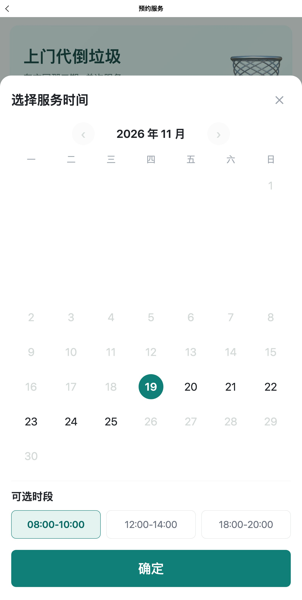 |  | 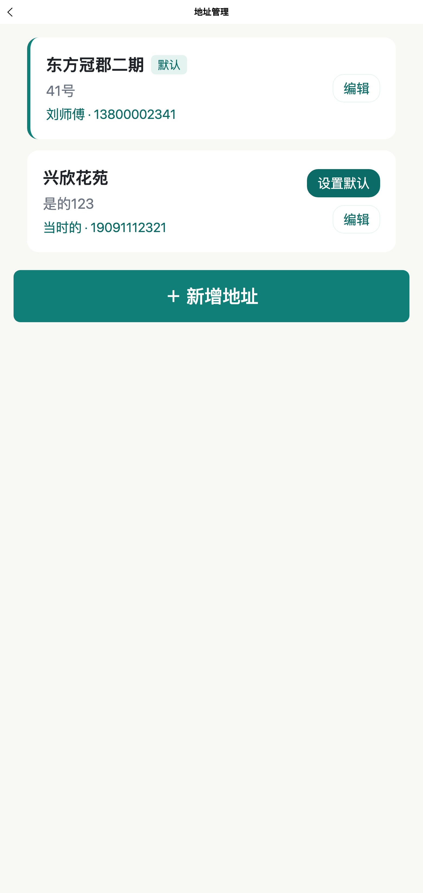 | 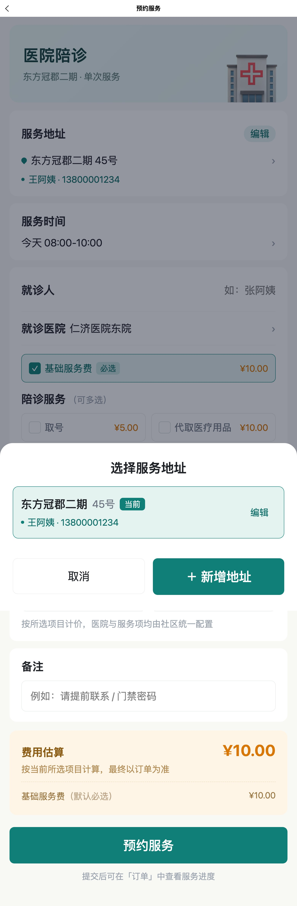 |  |

运营后台：

| 登录 | 订单管理 | 服务范围 | 时段库存 | 服务与价格 | 派单 |
|---|---|---|---|---|---|
| 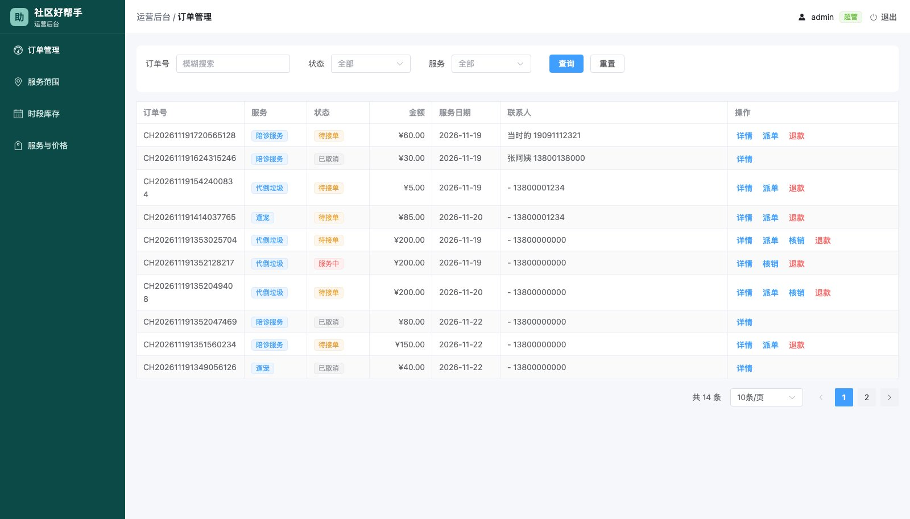 |  | 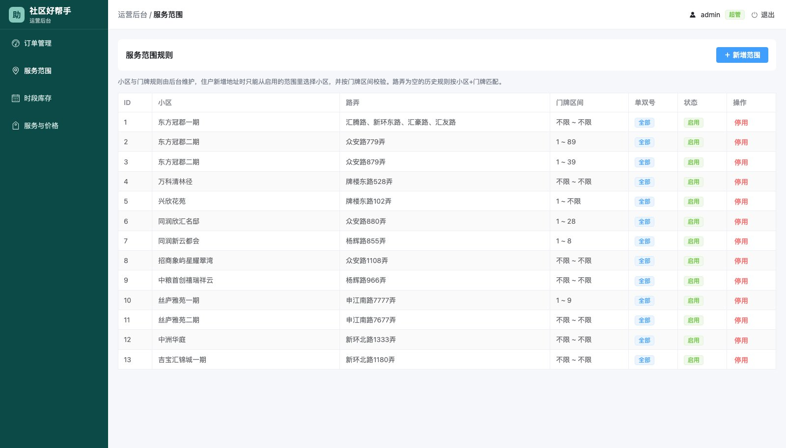 | 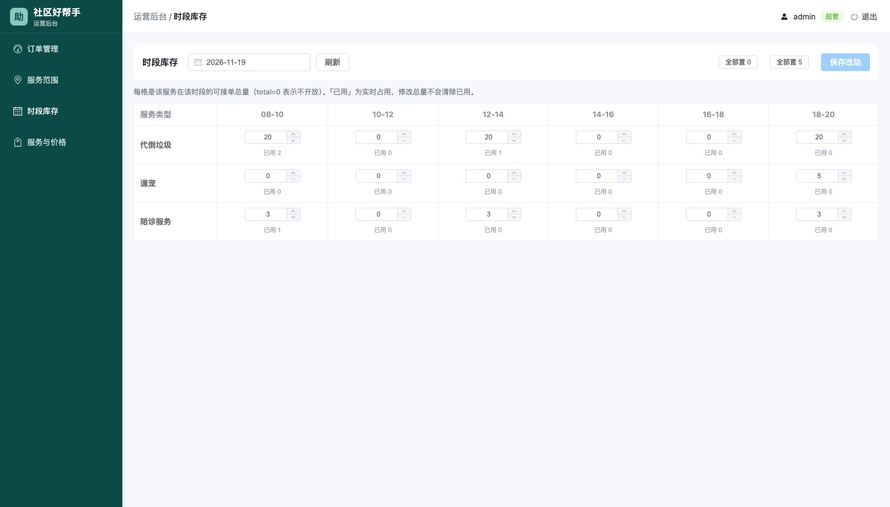 | 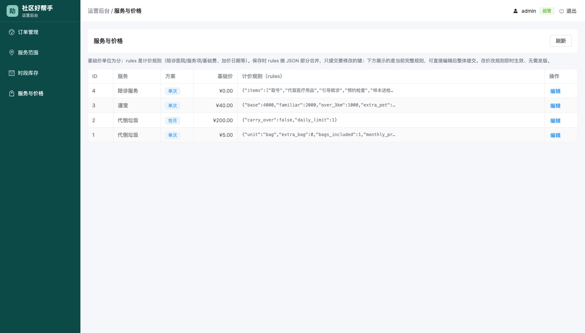 | 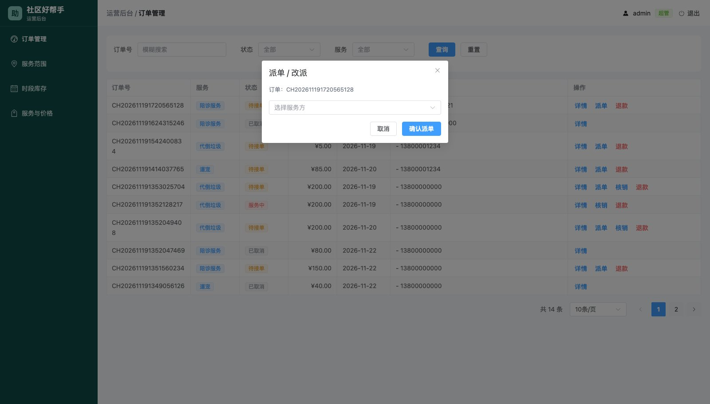 |

| 数据看板 | 财务管理 | 退款单 | 用户管理 | 订单详情(轨迹/记录) | 月卡核销 | 模板复制 | 账号管理 |
|---|---|---|---|---|---|---|---|
| 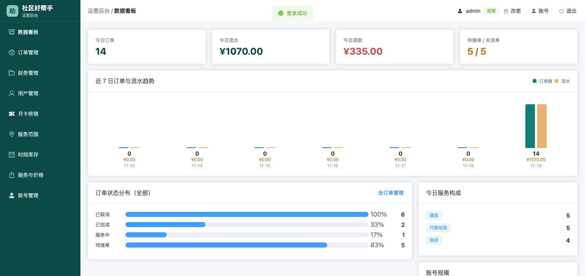 | 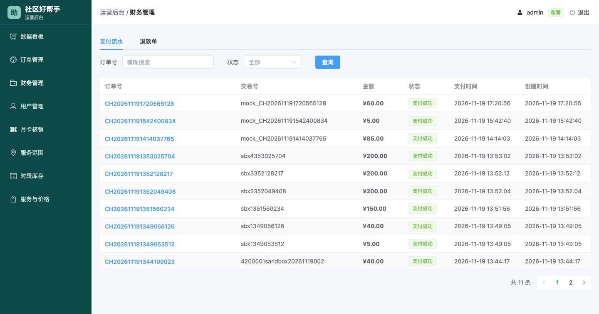 | 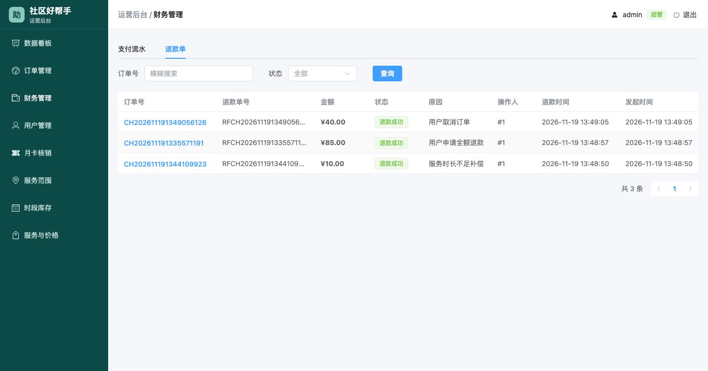 | 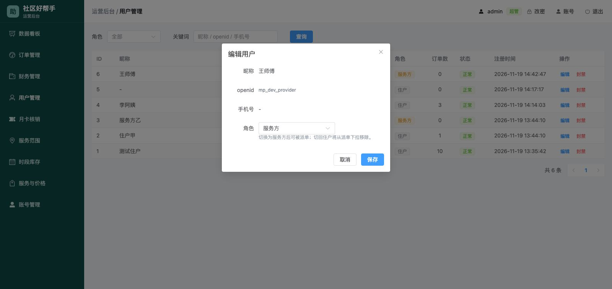 | 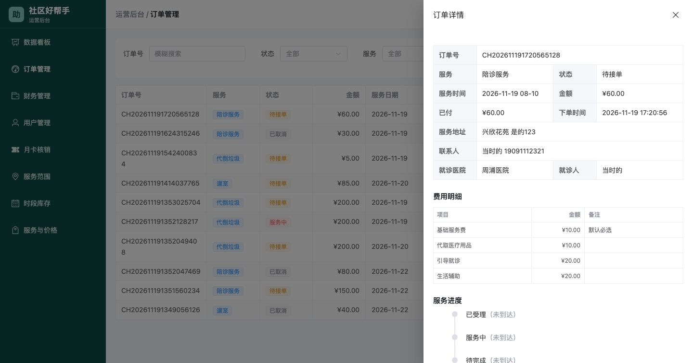 | 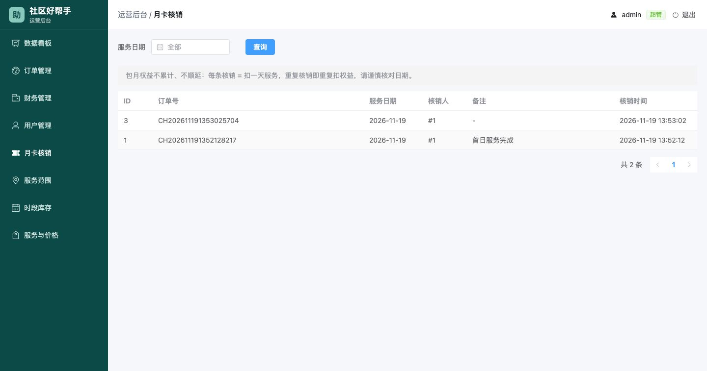 | 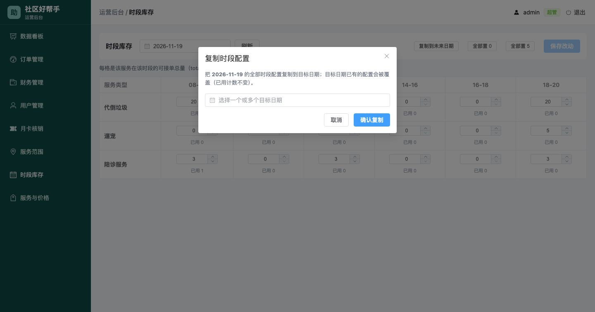 | 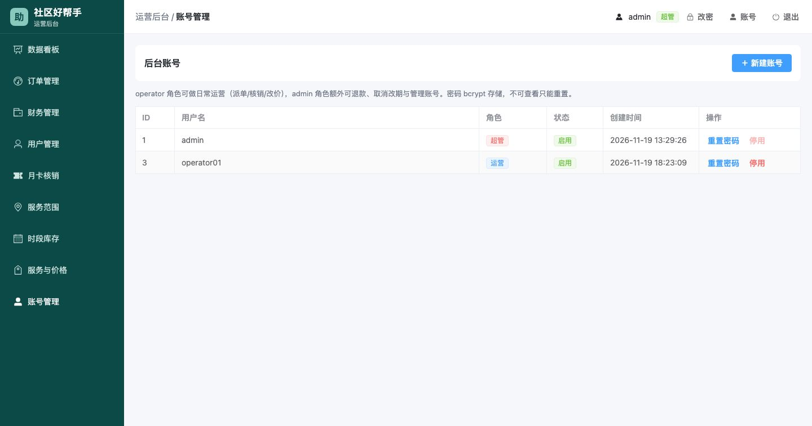 |

## 快速开始

```bash
cd server

# 1. 准备数据库
mysql -uroot -p -e "CREATE DATABASE community_handyman CHARACTER SET utf8mb4 COLLATE utf8mb4_unicode_ci"

# 2. 填 .env（把 MYSQL_DSN 里的 CHANGE_ME 换成你的密码）
cp .env.example .env && ${EDITOR:-vim} .env

# 3. 建表并灌种子数据
make migrate-up

# 4. 起服务
make run
curl http://127.0.0.1:8080/healthz
```

生产环境用 pm2 托管，见 `server/deployments/`。

### 用户端小程序

```bash
cd miniapp
npm install
npm run dev:h5          # 浏览器预览（http://localhost:5173，API 走 vite proxy）
npm run dev:mp-weixin   # 产出 dist/dev/mp-weixin，用微信开发者工具打开
npm run build:mp-weixin # 生产构建
```

开发期不接微信登录，启动时用固定 openid 调 `/api/v1/dev/login` 自动建号。

用户端接口地址由 `miniapp/.env.*` 决定：`npm run dev:mp-weixin` 连本机 8080，`npm run build:mp-weixin` 连 `https://m.yubangbzz.com`；需要 dev 模式产物用 `npm run build:mp-weixin:dev`（`uni build` 默认是生产模式，别搞混）。

**支付当前默认跳过**：`configs/config.*.yaml` 的 `payment.skip_pay: true` 让下单直接按支付成功推进到「待接单」，不再弹支付。商户号与证书齐备后：

1. 把 `payment.provider` 改为 `wechat`、`skip_pay` 改为 `false`；
2. 前端 `pages/order/create.vue` 的 `startPay` 换成 `uni.requestPayment`（判断条件已按 `order.status === 'pending_payment'` 写好，无需改流程）；
3. 沙箱 `mock-pay` 接口仍保留，只用于 e2e 回归（`run_e2e.sh` 固定 `PAYMENT_SKIP_PAY=false`）。

### 运营后台

```bash
cd admin
npm install
npm run dev       # 浏览器预览 http://127.0.0.1:5174，/api 走 vite proxy 到 8080
npm run build     # 类型检查 + 生产构建到 dist/
```

账号密码用 `cd server && make seed-admin user=admin`（密码读 `.env` 的 `ADMIN_PASSWORD`）。登录后可使用：数据看板（今日订单/流水/退款/待派单）、订单管理（查询/派单/退款/核销/历史报价/操作轨迹/服务记录查看/代客取消/代客改期/CSV 导出）、财务管理（支付流水与退款单跟踪）、用户管理（角色切换 user↔provider、封禁解封）、月卡核销记录、服务范围（新增/编辑/启停）、时段库存（含模板复制到未来日期）、服务价格与计价规则、后台账号管理（超管专属：新建账号/启停/重置密码，顶栏支持自助改密）。资金类操作（退款/代客取消/改期/账号管理）仅超管角色可用。

接口文档：服务启动后访问 `/swagger/index.html`（生产环境自动关闭）。改动注解后执行 `make doc` 重新生成。

## 技术栈

| 层 | 选型 |
|---|---|
| 后端 | Go 1.25 + Gin + GORM + golang-migrate |
| 数据库 | MySQL 8（utf8mb4） |
| 支付 | 微信支付 v3（当前：`skip_pay` 跳过支付 + 沙箱渠道，商户号下来后切换） |
| 存储 | 本地目录（可切换对象存储） |
| 部署 | systemd 托管二进制，`make build-linux` 交叉编译（详见 [docs/deploy.md](docs/deploy.md)） |

## 文档

- 需求文档 V1.1 —— `docs/邻有回应-社区生活服务预约平台需求文档.docx`
- 开发计划 —— `docs/邻有回应-开发计划.docx`
- 项目骨架说明 —— `docs/邻有回应-Go项目骨架说明.docx`
- 服务端开发说明 —— `server/README.md`

## 当前进度

已完成：下单支付闭环、履约（接单/节点/服务记录）、运营后台接口 + 前端（含数据看板、财务流水、用户管理、月卡核销、模板复制、CSV 导出）、包月核销、陪诊按项自动计价、用户端小程序六个页面（含地址管理）。

待办：微信登录与真实支付（需商户资质）、AC 全量回归、运营后台前端的视觉精修与权限细化。
