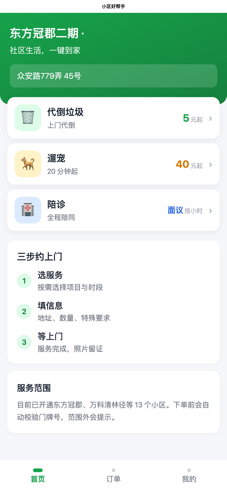
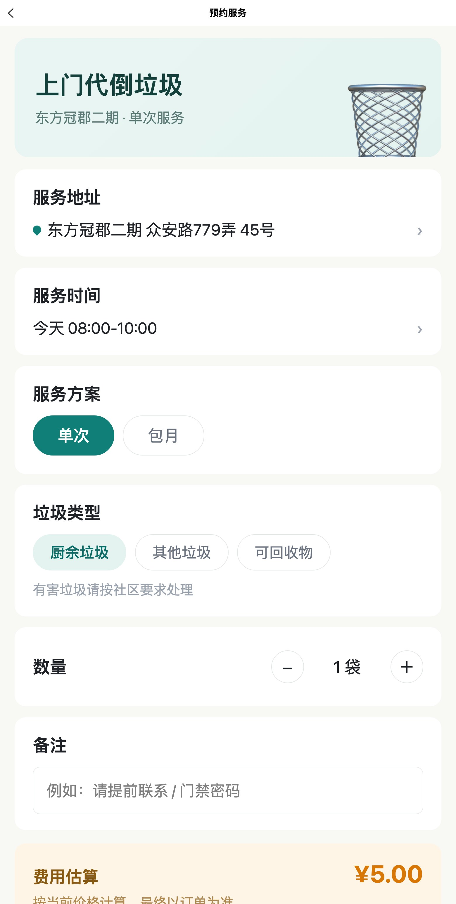
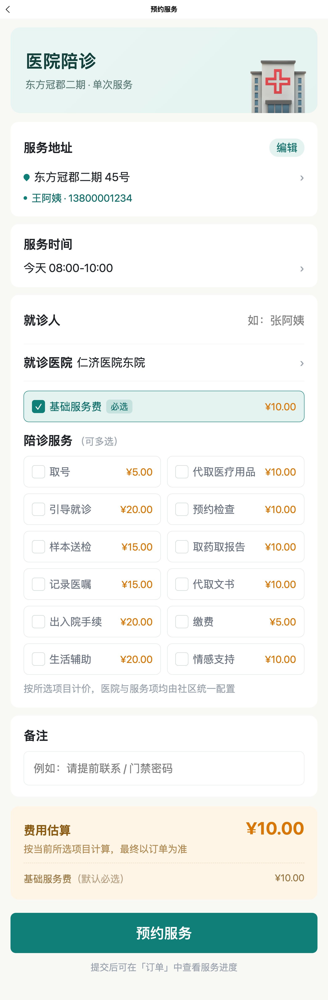
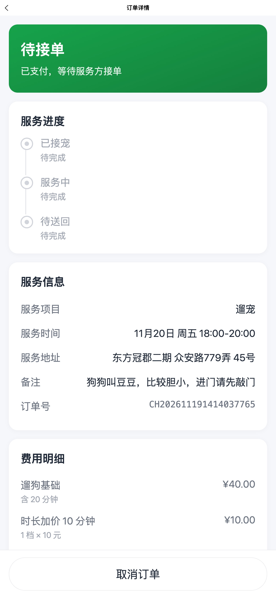

# 小区好帮手 · 社区生活服务预约平台

面向社区的上门与陪同服务预约平台：代倒垃圾、遛宠、陪诊。住户在小程序下单并支付，服务方接单履约，运营在后台管价格与退款。

## 目录

```
server/              服务端（Go + Gin + GORM + MySQL）
├── cmd/api          HTTP 服务入口
├── cmd/migrate      数据库迁移与种子数据
├── internal/        业务代码（分层见 server/README.md）
├── migrations/      golang-migrate SQL
└── configs/         配置文件
miniapp/             用户端小程序（uni-app + Vue3 + TypeScript）
├── src/pages       首页、预约、订单列表、订单详情、我的、地址管理
├── src/api         接口封装（与 swagger.json 对齐）
├── src/store       Pinia 状态
└── src/utils       请求层与格式化
docs/                产品文档、设计稿与页面截图
```

> 运营后台前端尚未开工，后台接口已就绪。

## 页面

| 首页 | 预约 | 日历选择 | 陪诊服务（基础费必选） | 地址管理 | 地址选择 | 订单详情 |
|---|---|---|---|---|---|---|
|  |  |  |  |  |  |  |

## 快速开始

```bash
cd server

# 1. 准备数据库
mysql -uroot -p -e "CREATE DATABASE community_handyman CHARACTER SET utf8mb4 COLLATE utf8mb4_unicode_ci"

# 2. 填 .env（把 MYSQL_DSN 里的 CHANGE_ME 换成你的密码）
cp .env.example .env && ${EDITOR:-vim} .env

# 3. 建表并灌种子数据
make migrate-up

# 4. 起服务
make run
curl http://127.0.0.1:8080/healthz
```

生产环境用 pm2 托管，见 `server/deployments/`。

### 用户端小程序

```bash
cd miniapp
npm install
npm run dev:h5          # 浏览器预览（http://localhost:5173，API 走 vite proxy）
npm run dev:mp-weixin   # 产出 dist/dev/mp-weixin，用微信开发者工具打开
npm run build:mp-weixin # 生产构建
```

开发期不接微信登录，启动时用固定 openid 调 `/api/v1/dev/login` 自动建号；支付走沙箱 `mock-pay` 接口。接入商户号后替换 `src/store/user.ts` 的 `ensureLogin` 与 `startPay` 即可，页面不用改。

接口文档：服务启动后访问 `/swagger/index.html`（生产环境自动关闭）。改动注解后执行 `make doc` 重新生成。

## 技术栈

| 层 | 选型 |
|---|---|
| 后端 | Go 1.25 + Gin + GORM + golang-migrate |
| 数据库 | MySQL 8（utf8mb4） |
| 支付 | 微信支付 v3（当前为沙箱实现，商户号下来后切换） |
| 存储 | 本地目录（可切换对象存储） |
| 部署 | pm2 托管二进制 |

## 文档

- 需求文档 V1.1 —— `docs/小区好帮手-社区生活服务预约平台需求文档.docx`
- 开发计划 —— `docs/小区好帮手-开发计划.docx`
- 项目骨架说明 —— `docs/小区好帮手-Go项目骨架说明.docx`
- 服务端开发说明 —— `server/README.md`

## 当前进度

已完成：下单支付闭环、履约（接单/节点/服务记录）、运营后台接口、包月核销、陪诊按项自动计价、用户端小程序五个页面。

待办：运营后台前端、服务方端页面、微信登录与真实支付（需商户资质）、AC 全量回归。
